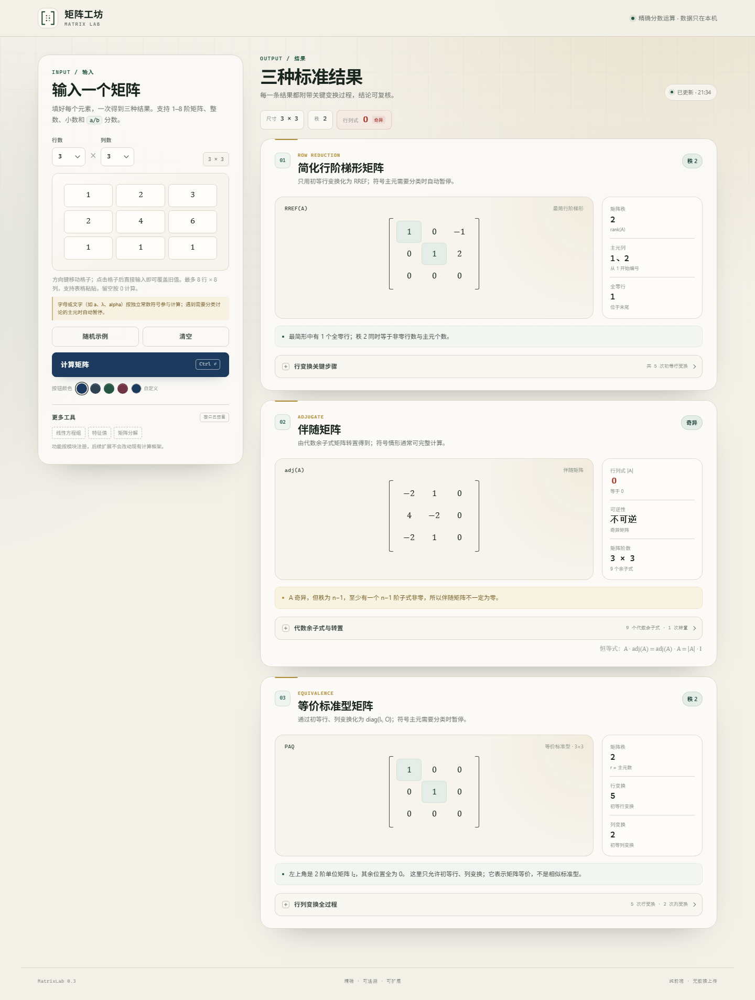
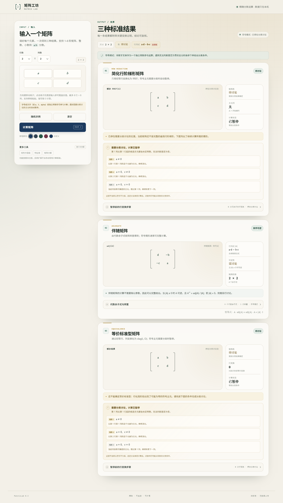

# 矩阵工坊 · MatrixLab

一个零依赖、可在本地或 GitHub Pages 直接打开的矩阵计算小工具。输入矩阵尺寸和每个元素，一次得到：

1. **简化行阶梯形矩阵（RREF）**：展示每一次初等行变换及中间矩阵。
2. **伴随矩阵 adj(A)**：展示代数余子式矩阵与转置过程；非方阵会明确提示不适用。
3. **等价标准型矩阵**：通过初等行、列变换化为 `diag(Iᵣ, O)`，保留完整的行/列变换过程。

所有数值计算使用 `BigInt` 精确分数进行，不使用浮点数近似。输入 `0.1`、`-2.5`、`3/7` 等值都不会产生舍入误差。

除此之外，输入中还可以包含**符号常数**。例如在元素中填 `a`、`b`、`λ`、`alpha`，它们会被当作相互独立的常数参与矩阵运算：

- RREF 和等价标准型在需要判断某个主元是否为零时**自动停下**，并列出继续计算所需的分类条件；
- 伴随矩阵通常不需要除法，因此可以完整计算，行列式会以含参数的表达式显示；
- 如果全程不需要判断符号主元，则会直接得到完整结果，不会强行打断。

> 一个输入格对应一个独立常数符号，例如 `a+b` 会被视为名为 “a+b” 的单个常数，而不会在格内展开算式。符号伴随矩阵当前展开到 `6 × 6`。

<p align="center">
  
</p>

<details>
  <summary>符号模式与分类讨论预览</summary>
  <p align="center">
    
  </p>
</details>

## 启动

直接双击 `index.html`，或双击 `启动矩阵工坊.bat`。不需要安装依赖，不需要联网。

使用较新的 Chrome、Edge 或 Firefox 即可。所有数据只在浏览器本机处理，不会上传。

## 使用方式

- 用“行数 / 列数”选择矩阵尺寸，支持 `1 × 1` 到 `8 × 8`。
- 元素支持整数、小数、负数和 `a/b` 分数；留空按 0 计算。
- 非数字文本会被识别为常数符号，参与符号计算；遇到需要分类讨论的主元时自动暂停并给出条件。
- 点击任意输入格后会自动全选旧值，直接输入新数字即可覆盖，无需先删除。
- 修改输入时，上一次的计算结果会保留在下方，并显示“输入已修改”提示；点击“计算矩阵”再刷新。
- 方向键可在格子之间上下左右移动；`Enter` 跳到下一个输入格，在最后一格按 `Enter` 或按 `Ctrl + Enter` 计算。
- 从电子表格复制的制表符/换行数据可以直接粘贴；矩阵会自动扩展，最多 8 行 8 列。
- 展开每张结果卡底部的“关键步骤”查看变换过程。
- “随机示例”会生成一个随机矩阵并立即计算，“清空”会清空输入和结果。
- “计算矩阵”按钮默认使用深海蓝；下方“按钮颜色”可切换预设色，或通过取色器自定义颜色。选择会被记住，点击第一个“深海蓝”色块即可恢复默认。

## 目录结构

```text
matrix-lab/
├─ index.html                 页面入口
├─ css/styles.css             全部样式
├─ js/
│  ├─ core/
│  │  ├─ fraction.js          BigInt 精确分数
│  │  ├─ matrices.js          矩阵基础工具
│  │  ├─ algorithms.js        数值版 RREF / 行列式 / 伴随 / 等价标准型
│  │  └─ symbolic.js          符号常数、分类讨论与符号版算法
│  ├─ ui/
│  │  ├─ dom.js               轻量 DOM 工具
│  │  └─ components.js        矩阵、分数、步骤时间线等组件
│  ├─ features/
│  │  ├─ registry.js          功能注册表
│  │  ├─ rref.js              行最简形结果卡
│  │  ├─ adjugate.js          伴随矩阵结果卡
│  │  └─ standard-form.js     等价标准型结果卡
│  └─ app.js                  输入编辑器与页面编排
├─ docs/                       README 预览图
├─ tests/
│  ├─ core.test.js            数值数学核心测试
│  ├─ symbolic.test.js        符号运算与分类讨论测试
│  └─ ui-check.mjs            浏览器冒烟测试（Chrome DevTools 协议）
├─ CHANGELOG.md               版本记录
├─ 启动矩阵工坊.bat
└─ package.json
```

## 扩展新功能

界面上的结果卡由功能注册表生成，新增工具不需要改动 `app.js` 的输入编辑器或页面框架。

在 `js/features/` 中新建一个脚本，例如 `inverse.js`：

```js
(function (root) {
  const MatrixLab = root.MatrixLab;
  const { el } = MatrixLab.ui.dom;
  const C = MatrixLab.ui.components;

  MatrixLab.featureRegistry.register({
    id: 'inverse',
    order: 40, // 决定结果卡顺序
    eyebrow: 'INVERSE',
    title: '逆矩阵',
    description: '仅对可逆方阵有定义。',
    compute(matrix) {
      // 返回交给 render 的数据
      return { /* ... */ };
    },
    badge(model) {
      return '逆矩阵';
    },
    render(model) {
      return el('div', { class: 'feature-body' }, /* 使用 C.matrixBlock(...) 等组件 */);
    },
  });
})(globalThis);
```

然后在 `index.html` 中，把它加到其他 `features/*.js` 之后、`app.js` 之前：

```html
<script defer src="js/features/inverse.js"></script>
```

核心数学函数都在 `MatrixLab.algorithms` 中，功能模块可以复用。若新工具需要新的算法，优先放进 `js/core/`，继续保持与界面无关、可单独测试。

## 测试

需要 Node.js（项目本身运行不依赖 Node）。

```bash
# 精确数值 + 符号运算测试
npm test

# 浏览器界面冒烟测试（需要本机安装 Chrome 或 Edge）
node tests/ui-check.mjs
```

浏览器测试会检查结果卡渲染、按钮颜色、输入覆盖、方向键、行列式 / 伴随矩阵、非方阵提示、符号分类讨论、8×8 布局与移动端横向溢出，并将截图输出到 `tests/artifacts/`。

## 说明

- “等价标准型”使用初等行、列变换，不是相似标准型。
- 伴随矩阵按 `adj(A) = Cᵀ` 计算，其中 `Cᵢⱼ = (−1)ⁱ⁺ʲ Mᵢⱼ`；对奇异方阵同样有定义。
- 1×1 矩阵按通常约定处理：`adj([a]) = [1]`。
- 分数统一使用行内斜杠形式，例如 `3/2`，避免上下堆叠在小矩阵中挤压错位。
- 分数系数或复合符号因子参与乘法时会整体加括号，例如 `(1/2)·a`、`−(a + b)·R₁`，避免把分子/分母的范围读错。
- 当前没有复数算术；含字母的文本（包括 `i`）都按独立常数符号处理，格内算式不会被展开。

版本变化见 [CHANGELOG.md](CHANGELOG.md)。
